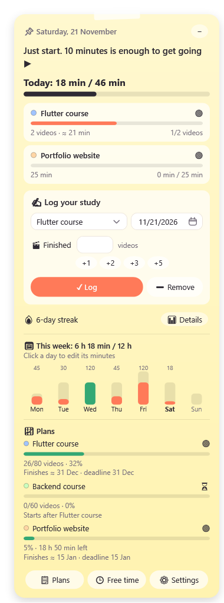
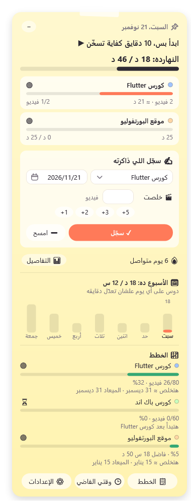
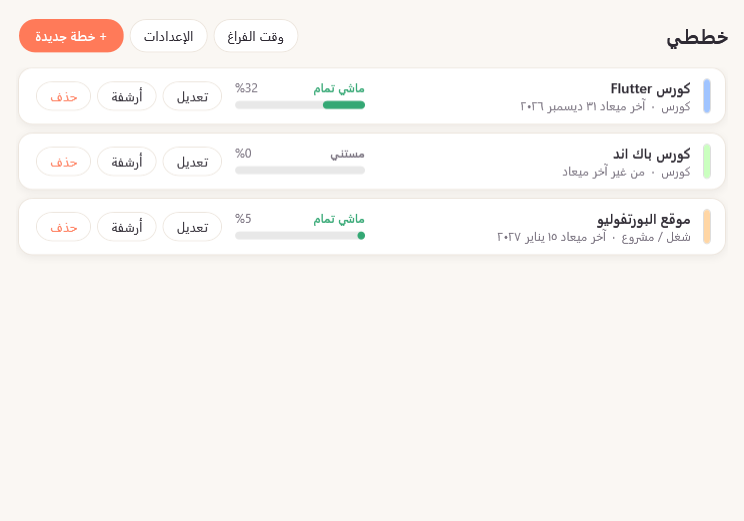
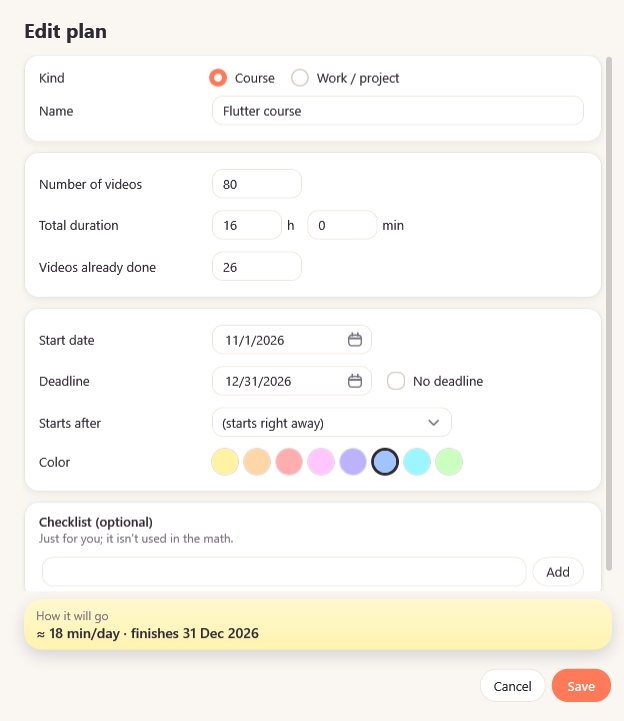
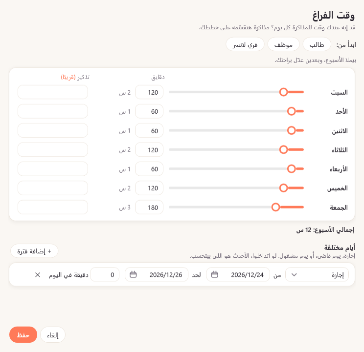
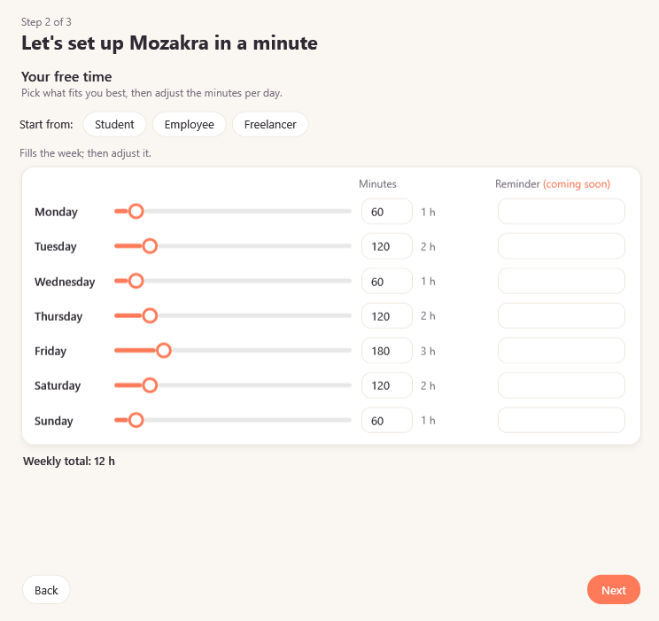

<p align="center">
  
</p>

<h1 align="center">Mozakra · مذاكرة</h1>

<p align="center">
  <b>A sticky note on your desktop that tells you how much to study today.</b><br>
  Add your courses and projects, say how much free time you have, and Mozakra works out a realistic daily target.
</p>

<p align="center">
  <a href="https://github.com/Venomexeno/Mozakra/actions/workflows/ci.yml"></a>
  <a href="https://github.com/Venomexeno/Mozakra/releases/latest"></a>
  <a href="LICENSE"></a>
  <a href="https://github.com/Venomexeno/Mozakra/releases"></a>
</p>

<p align="center">
  <a href="#بالعربي">بالعربي ⬇</a>
</p>

---

<p align="center">
  
  &nbsp;&nbsp;
  
</p>

Mozakra is a free, open-source Windows app for **self-learners**: people working through video
courses and side projects next to a job or school. Instead of a to-do list you have to plan yourself,
it looks at your deadlines and your free time and answers one question: *what should I do today?*

## Features

- **Sticky note on the desktop.** Pinned to the desktop layer: it's there when you look at the desktop
  (or press Win+D) and stays out of the way behind your apps.
- **Two kinds of plans.** *Courses* (number of videos and total length)
  and *work/projects* (estimated hours, with an optional checklist).
- **A daily target that adapts.** Miss a day and the rest is spread over the coming days. Do extra and
  the next days get lighter.
- **Free time your way.** Minutes per weekday, plus vacations and extra-free days.
- **"Start after".** A plan can wait until another one is finished (EF Core after LINQ, for example).
- **Honest warnings.** When a deadline can't be met you see why ("Needs 8 h, you have 2 h") and one-click
  fixes: move the deadline to a realistic date, add free time, or leave it.
- **Quick logging by hand.** For a course, log how many videos you finished (Mozakra works out the time from
  the course's average); for a project, log the minutes. Works for today or any past day, with undo (Ctrl+Z).
- **Streak, week view and stats.** Days without free time never break your streak.
- **Arabic and English**, with a full right-to-left layout for Arabic.
- **Updates itself** from GitHub Releases.

<p align="center">
  
  
</p>
<p align="center">
  
  
</p>

### How the daily target is calculated

1. **What's left.** For a course: the length of the videos you haven't watched yet.
   For a project: your estimate minus the time you've logged.
2. **Your free time until the deadline.** Mozakra adds up your free minutes from today to the deadline
   (vacations count as 0).
3. **Today's share.** Today gets the same share of the remaining work as its share of that free time.
   If today has 2 h out of 10 h left before the deadline, today's target is 20% of what's left.

Plans with the nearest deadline go first. Plans without a deadline share whatever free time is left.
Because the target is recalculated every day, missed and extra time sort themselves out.

### Privacy

Everything stays on your PC, in `%APPDATA%\Mozakra\state.json` (with a daily backup of the last 7 days).
No account, no server, no tracking. The only network call is the update check against GitHub Releases.
You can export and import your data from Settings.

## Download and install

1. Download **[Mozakra-win-Setup.exe](https://github.com/Venomexeno/Mozakra/releases/latest/download/Mozakra-win-Setup.exe)**
   from the [latest release](https://github.com/Venomexeno/Mozakra/releases/latest).
2. Run it. It installs for your user only (no admin needed), adds Desktop and Start-menu shortcuts and
   starts Mozakra with Windows (you can turn that off in Settings).

Requires Windows 10 or 11 (64-bit). Nothing else to install.

### "Windows protected your PC"

The first time you run the Setup, Windows SmartScreen will probably show a blue
**"Windows protected your PC"** window. Click **More info**, then **Run anyway**.

This appears because Mozakra isn't code-signed yet: signing certificates cost money, and SmartScreen
warns about any new app that hasn't built up a reputation. The installer is built from this repository's
source by [GitHub Actions](https://github.com/Venomexeno/Mozakra/actions/workflows/release.yml), so you
can check exactly what's in it. Free code signing for open source (SignPath Foundation) is on the roadmap.

## Quick start

1. **Pick your language and free time.** The first-run wizard has presets (Student, Employee,
   Freelancer) you can adjust per day.
2. **Add a plan.** A course (videos and total length) or a project (estimated hours), with a deadline
   if you have one.
3. **Study, then log it** on the note: the videos you finished for a course, or the minutes for a project.
   That's it: tomorrow's target updates itself.

Hide the note with **−**; bring it back from the tray icon.

## FAQ

**Where is my data?** `%APPDATA%\Mozakra`. Settings → *Open the data folder* takes you there.

**Will uninstalling delete my data?** No. Uninstalling (Settings → Apps) removes the app but keeps
`%APPDATA%\Mozakra`.

**Why is today's target bigger than my free time?** The deadline isn't reachable with your current free
time. The note shows a warning with a realistic date; accept it, add free time, or leave it.

**Can I move my data to another PC?** Settings → Export, then Import on the other PC.

**Does it work on macOS or Linux?** No, Mozakra is Windows-only (WPF).

## Roadmap

- **v1.1:** reminder notifications at the time you choose for each day.
- **v1.2:** import a course from a YouTube playlist (videos and durations filled in for you).
- Later: backup to a synced folder (OneDrive), dark mode,
  a weekly report, and code signing.

Ideas and bug reports are welcome in [Issues](https://github.com/Venomexeno/Mozakra/issues).

## Build from source

You need the [.NET 10 SDK](https://dotnet.microsoft.com/download) on Windows.

```powershell
git clone https://github.com/Venomexeno/Mozakra.git
cd Mozakra
dotnet build
dotnet test
dotnet run --project src/Mozakra.App
```

To try it without touching your real data, point it at another folder first:
`$env:MOZAKRA_DATA_DIR = "$env:TEMP\mozakra-test"`.

`./build/pack.ps1` builds a local installer into `artifacts/releases`.

### Project structure

```
src/
  Mozakra.Core/        models, scheduling engine, persistence (no UI, unit tested)
  Mozakra.App/         WPF app: note window, screens, tray, localization (MVVM + DI)
tests/
  Mozakra.Core.Tests/  scheduling and persistence tests
  Mozakra.App.Tests/   view-model tests for the note
build/pack.ps1         local Velopack installer
assets/                logo and screenshots
```

## Contributing

Bug reports, translations and pull requests are welcome.

- Open an issue first for bigger changes, so we can agree on the approach.
- Keep `dotnet build` free of warnings and `dotnet test` green; add tests for scheduling changes.
- User-facing text goes in both `Localization/*.ar.xaml` and `*.en.xaml`, never hard-coded in views.

## License

[MIT](LICENSE) © Nadeem Ibrahim

---

<div dir="rtl">

## بالعربي

**مذاكرة** نوتة لاصقة على سطح المكتب بتقولك تذاكر قد إيه النهارده.
بتضيف الكورسات والمشاريع بتاعتك، وتقول وقتك الفاضي، ومذاكرة تحسبلك هدف يومي واقعي.

البرنامج مجاني ومفتوح المصدر، معمول لـ **اللي بيتعلموا لوحدهم**: اللي بيذاكروا كورسات فيديو
وبيعملوا مشاريع جانبية جنب الشغل أو الكلية. بدل ما تخطط كل يوم بنفسك، البرنامج بيبص على
مواعيدك ووقتك الفاضي ويجاوب على سؤال واحد: *أعمل إيه النهارده؟*

### المميزات

- **نوتة لاصقة على سطح المكتب.** متثبتة في طبقة سطح المكتب: تلاقيها لما تبص على الديسكتوب
  (أو تدوس Win+D)، ومش بتضايقك وانت شغال لأنها بتستخبى ورا البرامج.
- **نوعين خطط.** *كورسات* (عدد الفيديوهات والمدة الكلية)
  و*شغل / مشاريع* (ساعات متوقعة، وقائمة مهام اختيارية).
- **هدف يومي بيتظبط لوحده.** لو فوّت يوم، الباقي بيتوزع على الأيام الجاية. لو عملت زيادة، الأيام
  الجاية بتخف.
- **وقتك الفاضي زي ما انت عايز.** دقايق لكل يوم في الأسبوع، وأجازات وأيام فاضية زيادة.
- **"تبدأ بعد".** خطة ممكن تستنى لحد ما خطة تانية تخلص (EF Core بعد LINQ مثلًا).
- **تحذيرات صريحة.** لو الميعاد مش هيلحق، هتشوف السبب ("محتاج 8 س، وعندك 2 س") وحلول بدوسة واحدة:
  مدّ الميعاد لتاريخ واقعي، زوّد وقت فاضي، أو سيبها.
- **تسجيل سريع بإيدك.** في الكورس بتسجّل خلصت كام فيديو (ومذاكرة بتحسب الوقت من متوسط الكورس)، وفي المشروع
  بتسجّل الدقايق. ينفع للنهارده أو لأي يوم فات، ومعاه تراجع (Ctrl+Z).
- **سلسلة أيام، عرض للأسبوع وإحصائيات.** الأيام اللي مفيهاش وقت فاضي عمرها ما بتكسر السلسلة.
- **عربي وإنجليزي**، والعربي من اليمين للشمال بالكامل.
- **بيحدّث نفسه** من GitHub Releases.

### الهدف اليومي بيتحسب إزاي

1. **الباقي.** في الكورس: مدة الفيديوهات اللي لسه ما اتفرجتش عليها.
   في المشروع: الوقت المتوقع ناقص اللي سجلته.
2. **وقتك الفاضي لحد الميعاد.** البرنامج بيجمع دقايقك الفاضية من النهارده لحد آخر ميعاد (الأجازة = 0).
3. **نصيب النهارده.** النهارده بياخد من الشغل الباقي نفس نسبته من الوقت الفاضي. لو النهارده فيه
   2 س من 10 س فاضلين قبل الميعاد، هدفك النهارده 20% من الباقي.

الخطط اللي ميعادها أقرب بتاخد الأولوية. والخطط اللي من غير ميعاد بتتقسم على الوقت اللي فاضل.
وبما إن الهدف بيتحسب من جديد كل يوم، الأيام اللي فاتت والوقت الزيادة بيتظبطوا لوحدهم.

### الخصوصية

كل حاجة على جهازك بس، في `%APPDATA%\Mozakra\state.json` (ومعاها نسخة احتياطية يومية لآخر 7 أيام).
مفيش حساب ولا سيرفر ولا تتبع. الاتصال الوحيد بالنت هو التشييك على التحديثات من GitHub Releases.
وتقدر تصدّر بياناتك وتستوردها من الإعدادات.

### التحميل والتثبيت

1. نزّل **[Mozakra-win-Setup.exe](https://github.com/Venomexeno/Mozakra/releases/latest/download/Mozakra-win-Setup.exe)**
   من [آخر إصدار](https://github.com/Venomexeno/Mozakra/releases/latest).
2. شغّله. بيتثبت لليوزر بتاعك بس (من غير صلاحيات أدمن)، وبيعمل اختصار على سطح المكتب وفي قايمة
   ابدأ، وبيفتح مع Windows (تقدر تقفل ده من الإعدادات).

محتاج Windows 10 أو 11 (64-bit). مش محتاج تثبّت أي حاجة تانية.

#### شاشة "Windows protected your PC"

أول مرة تشغّل الـ Setup، غالبًا Windows SmartScreen هيطلعلك شاشة زرقا مكتوب فيها
**"Windows protected your PC"**. دوس **More info**، وبعدين **Run anyway**.

الشاشة دي بتظهر لأن البرنامج لسه مش موقّع رقميًا (code signing): شهادات التوقيع بفلوس، وSmartScreen
بيحذّر من أي برنامج جديد لسه معملش سمعة. الـ Setup بيتبني من الكود اللي في الريبو ده عن طريق
[GitHub Actions](https://github.com/Venomexeno/Mozakra/actions/workflows/release.yml)، يعني تقدر تشوف
بالظبط إيه اللي جواه. والتوقيع المجاني للمشاريع المفتوحة (SignPath Foundation) في الخطة.

### تبدأ إزاي

1. **اختار اللغة ووقتك الفاضي.** أول مرة هيظهرلك معالج فيه اختيارات جاهزة (طالب، موظف، فري لانسر)
   وتقدر تعدّل كل يوم.
2. **ضيف خطة.** كورس (عدد الفيديوهات والمدة الكلية) أو مشروع (ساعات متوقعة)، ومعاها آخر ميعاد لو عندك.
3. **ذاكر، وبعدين سجّل** على النوتة: عدد الفيديوهات اللي خلصتها لو كورس، أو الدقايق لو مشروع. بس كده: هدف
   بكرة بيتحدّث لوحده.

تقدر تخبي النوتة بزرار **−**، وترجّعها من أيقونة البرنامج جنب الساعة.

### أسئلة متكررة

**بياناتي فين؟** في `%APPDATA%\Mozakra`. من الإعدادات ← *افتح فولدر البيانات*.

**لو مسحت البرنامج بياناتي هتتمسح؟** لأ. المسح (Settings ← Apps) بيشيل البرنامج بس، و`%APPDATA%\Mozakra` بيفضل زي ما هو.

**ليه هدف النهارده أكبر من وقتي الفاضي؟** معناها إن الميعاد مش هيلحق بوقتك الفاضي الحالي. النوتة
هتوريك تحذير فيه تاريخ واقعي: وافق عليه، أو زوّد وقت فاضي، أو سيبها.

**أقدر أنقل بياناتي لجهاز تاني؟** الإعدادات ← تصدير، وبعدين استيراد على الجهاز التاني.

**بيشتغل على macOS أو Linux؟** لأ، مذاكرة على Windows بس (WPF).

### الخطة الجاية

- **v1.1:** تنبيهات تفكرك تذاكر في الميعاد اللي تختاره لكل يوم.
- **v1.2:** استيراد كورس من playlist على YouTube (الفيديوهات ومددها بتتملي لوحدها).
- بعد كده: نسخة احتياطية على فولدر متزامن (OneDrive)، الوضع الداكن،
  تقرير أسبوعي، والتوقيع الرقمي.

الأفكار والمشاكل مرحب بيها في [Issues](https://github.com/Venomexeno/Mozakra/issues).

### تبنيه من الكود

محتاج [.NET 10 SDK](https://dotnet.microsoft.com/download) على Windows.

</div>

```powershell
git clone https://github.com/Venomexeno/Mozakra.git
cd Mozakra
dotnet build
dotnet test
dotnet run --project src/Mozakra.App
```

<div dir="rtl">

علشان تجرّبه من غير ما تلمس بياناتك الحقيقية، وجّهه لفولدر تاني الأول:
`$env:MOZAKRA_DATA_DIR = "$env:TEMP\mozakra-test"`.

و`./build/pack.ps1` بيبني Setup محلي في `artifacts/releases`.

#### تقسيم المشروع

- `src/Mozakra.Core`: الموديلز، حسبة الجدول، والحفظ (من غير واجهة، وعليه تستات).
- `src/Mozakra.App`: برنامج WPF: النوتة، الشاشات، أيقونة جنب الساعة، والترجمة (MVVM + DI).
- `tests/Mozakra.Core.Tests`: تستات الجدول والحفظ.
- `tests/Mozakra.App.Tests`: تستات الـ ViewModel بتاع النوتة.
- `build/pack.ps1`: Setup محلي بـ Velopack.
- `assets/`: اللوجو والصور.

### المساهمة

البلاغات عن المشاكل والترجمات والـ pull requests مرحب بيها.

- افتح issue الأول للتغييرات الكبيرة علشان نتفق على الطريقة.
- خلي `dotnet build` من غير تحذيرات و`dotnet test` كله ناجح، وضيف تستات لأي تغيير في حسبة الجدول.
- أي كلام بيظهر لليوزر يتحط في `Localization/*.ar.xaml` و`*.en.xaml` الاتنين، ومش يتكتب جوه الـ views.

### الترخيص

[MIT](LICENSE) © Nadeem Ibrahim

</div>
